# Timing Attack Lab

This is a CS-3002 Information Security term project about side-channel attacks and countermeasures. It demonstrates a timing attack against a PIN login that exits at the first wrong digit, then compares it with a login that uses Python's constant-time `hmac.compare_digest`. The web app runs the attack and shows candidate timings in live charts.

## Live demo

- Frontend: [Vercel site](https://timing-attack-lab.vercel.app/)
- Backend: [Railway API](https://timing-attack-lab-production.up.railway.app/)
- Swagger UI: [API docs](https://timing-attack-lab-production.up.railway.app/docs)
- Health check: [API health](https://timing-attack-lab-production.up.railway.app/api/health)

The backend is on a free tier and may need a few seconds to wake up. Open `/api/health` first.

## Team and roles

| Team member | Student ID | Role |
|---|---|---|
| Sameer Ahmed | 24I-2047 | Attack core |
| Muhammad Subhan | 24I-2082 | Backend, API, and deployment |
| Affaf Shahid | 24I-2009 | Frontend, report, and slides |

## What the project shows

A timing attack uses small differences in how long a server takes to answer. The vulnerable login compares the guess and PIN one digit at a time. It stops at the first mismatch, so a guess with more correct leading digits takes longer.

The secure login uses `hmac.compare_digest` for same-length guesses. Its comparison time does not depend on how many leading digits are correct, so the timing does not point to the next digit.

## How the attack works

The automated attack tries each possible digit at the current position. It sends `samples` guesses for each candidate and uses the median response time. It chooses the candidate with the highest median, since the vulnerable comparison runs for longer when that digit is correct, then moves to the next position.

The attack builds each guess from the recovered prefix, the candidate digit, and zeroes for the positions not tested yet. Confidence is the relative gap between the highest and second-highest candidate medians: `(highest - second highest) / highest`. The UI shows the candidate medians in a bar chart and records each chosen digit with its confidence.

If a probe is accepted as the correct PIN, the attack returns immediately. The zero padding can sometimes complete the PIN early. See [Known limitations](#known-limitations).

## Countermeasures and timing settings

- **Constant-time comparison:** The secure endpoint uses `hmac.compare_digest` instead of an early-exit loop.
- **Rate limiting:** A per-session rolling window limits the number of guesses in 60 seconds. Further requests receive HTTP 429. This slows the attack but does not remove the timing leak.
- **Lockout:** A session locks after the configured number of consecutive failed guesses and returns HTTP 423. A successful login resets the failure count. Applying new settings also clears the count and lockout.
- **Random jitter:** The server adds a random delay of up to the configured amount after the comparison. It adds noise to round-trip timings, but enough samples can average out that noise. It does not change the measured compare time.
- **Server-side timing mode:** This is a measurement option, not a defence. When enabled for a session, login responses can include the time spent inside the comparison. To use it for an attack, turn on both the session's server-side timing setting and the attack's server-time option. It removes network delay and jitter from the measurement.
- **Leak amplifier:** The vulnerable comparison can add a small delay in milliseconds for every matched digit. This makes the leak visible over a network. Set it to 0 ms to examine the much smaller real leak.

## Project structure

```text
.
├── backend/
│   ├── app/
│   │   ├── main.py          FastAPI app, CORS setup, request models, and API routes
│   │   ├── compare.py       Vulnerable and constant-time comparison functions
│   │   ├── auth.py          Login checks, jitter, rate limits, and lockout handling
│   │   ├── ratelimit.py     Per-session sliding-window rate limiter
│   │   ├── sessions.py      In-memory PIN sessions and configuration
│   │   ├── attacks.py       Background attack jobs and timing probes
│   │   └── benchmark.py     Compare timing across different matching-prefix lengths
│   ├── attacker/
│   │   ├── attack.py        Digit-by-digit PIN recovery
│   │   └── stats.py         Median, candidate selection, and confidence calculations
│   └── requirements.txt     Python dependencies
├── frontend/
│   ├── src/
│   │   ├── App.tsx          Main app, session setup, tabs, and attack display
│   │   ├── api.ts           Typed API client and VITE_API_BASE setting
│   │   ├── format.ts        Timing and chart label formatting
│   │   ├── main.tsx         React entry point
│   │   ├── styles.css       App styles
│   │   └── components/
│   │       ├── AttackPanel.tsx     Attack controls and sample settings
│   │       ├── CandidateChart.tsx  Per-digit median timing chart
│   │       ├── ComparePanel.tsx    Comparison benchmark and graph
│   │       ├── DefencesPanel.tsx   Session settings and countermeasures
│   │       ├── HowItWorks.tsx      In-app explanation
│   │       ├── PinRegister.tsx     PIN recovery display
│   │       ├── ProbePanel.tsx      Manual login probing
│   │       ├── Tip.tsx             Help tips for controls
│   │       └── Tour.tsx            Guided app tour
│   ├── package.json         Frontend scripts and dependencies
│   └── vite.config.ts       Development server and API proxy
├── tests/
│   ├── test_api.py          API, session, countermeasure, and attack tests
│   ├── test_compare.py      Comparison function tests
│   └── test_recover_pin.py  Attack recovery tests
├── docs/
│   ├── api_contract.md                         API contract
│   ├── threat_model.md                         Threat model
│   ├── Timing_Attack_Lab_Technical_Report.pdf  Technical Report
│   └── screenshots/                            Screenshots from the demo
└── README.md
```

## API overview

| Method | Route | Purpose |
|---|---|---|
| `GET` | `/api/health` | Report server status, session count, and running attack count |
| `POST` | `/api/session` | Create an in-memory session with a random PIN |
| `GET` | `/api/session/{session_id}` | Get session status and settings |
| `PUT` | `/api/session/{session_id}/config` | Update amplifier, jitter, rate limit, lockout, or oracle settings |
| `POST` | `/api/login/vulnerable` | Check a guess using the early-exit comparison |
| `POST` | `/api/login/secure` | Check a guess using `hmac.compare_digest` |
| `POST` | `/api/attack/start` | Start an automated attack against the session |
| `GET` | `/api/attack/{attack_id}` | Get attack progress and results |
| `POST` | `/api/attack/{attack_id}/stop` | Stop an attack |
| `POST` | `/api/session/{session_id}/benchmark` | Measure both comparisons across matching-prefix lengths |

The PIN is not returned by the session endpoints. The API also serves FastAPI's Swagger UI at `/docs`.

## Run it locally

### Backend

Open PowerShell at the repository root, then run:

```powershell
cd backend
python -m venv .venv
.\.venv\Scripts\Activate.ps1
python -m pip install -r requirements.txt
uvicorn app.main:app --reload
```

Start Uvicorn from inside `backend` because `attacks.py` imports `attacker.attack` as a top-level package. Do not run `uvicorn backend.app.main:app` from the repository root.

### Frontend

Open a second PowerShell window at the repository root, then run:

```powershell
cd frontend
npm install
npm run dev
```

The Vite development server proxies `/api` requests to `http://127.0.0.1:8000`. In [api.ts](frontend/src/api.ts), the frontend reads `VITE_API_BASE`; it defaults to an empty string, which works with this proxy. Set it to the backend base URL when the frontend and backend are hosted separately.

### Environment variables

- `CORS_ORIGINS` is read by the backend. It is a comma-separated list of allowed browser origins and defaults to `http://localhost:5173`.
- `VITE_API_BASE` is read by the frontend build. It is the backend base URL, with no trailing path such as `/api`.

For local development, the default CORS origin and Vite proxy are sufficient. To set explicit local values in PowerShell:

```powershell
$env:CORS_ORIGINS = "http://localhost:5173"
$env:VITE_API_BASE = "http://127.0.0.1:8000"
```

Set environment variables in the terminal where you run the corresponding service. The repository does not include an `.env.example` file.

## Run the tests

Run the tests from the `backend` folder:

```powershell
cd backend
python -m pytest ..\tests -q
```

The current test run reports **21 passed and 1 skipped**. The skipped test checks the old missing-attacker-module case and skips when the attack implementation is present.

## Deployment

The backend is deployed on Railway and the frontend on Vercel. Set `CORS_ORIGINS` on Railway to include the full Vercel site origin, for example:

```text
https://timing-attack-lab.vercel.app/
```

If you allow more than one origin, separate them with commas. Set the Vercel `VITE_API_BASE` value to the Railway backend base URL. After deployment, open the backend `/api/health` endpoint if the free-tier service needs time to wake up.

## Screenshots and results

### A. Core attack

The first two images show the vulnerable attack result and its confidence table.

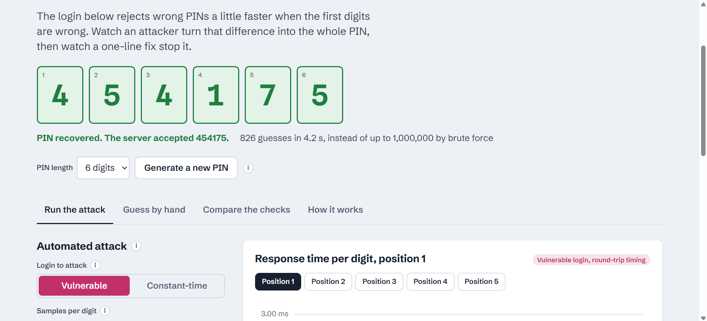

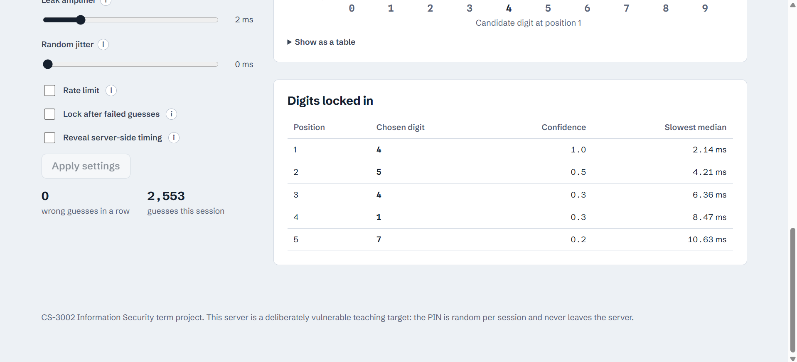

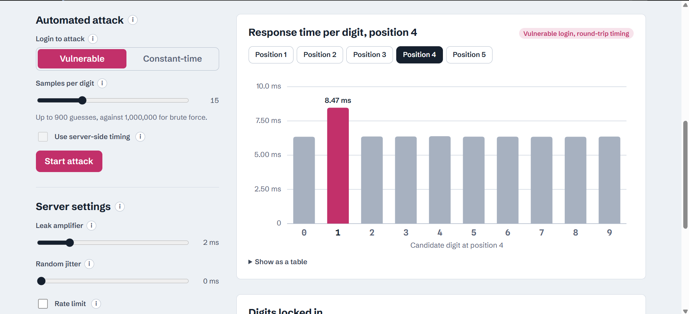

The next two images show the constant-time attack failure and its confidence table.

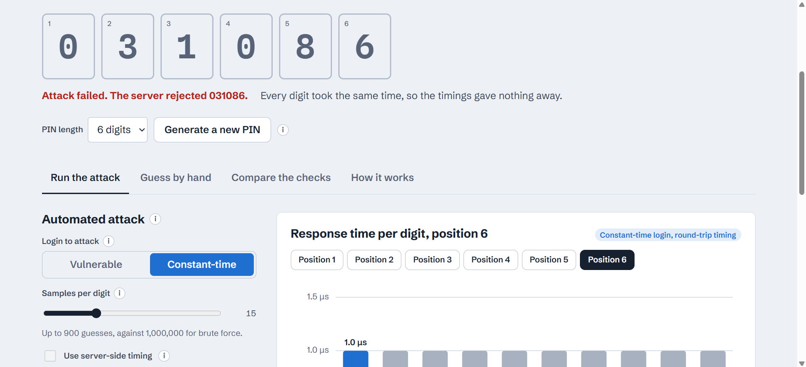

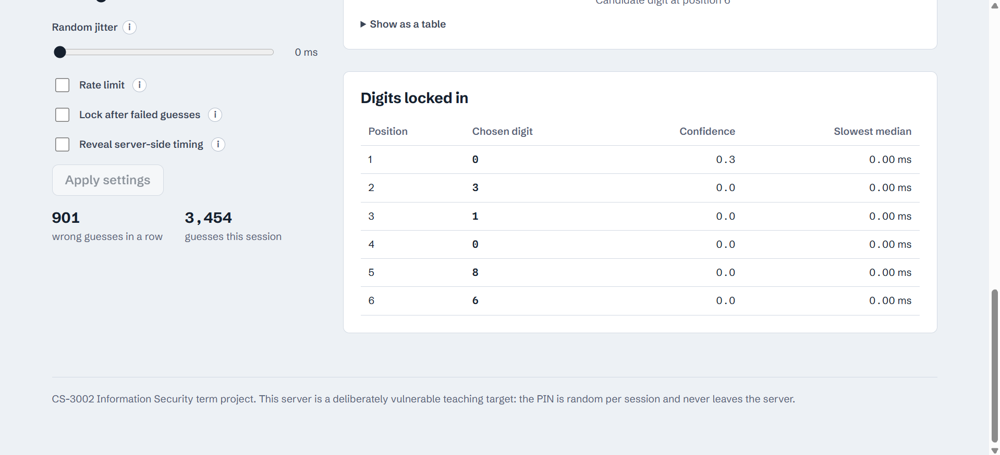

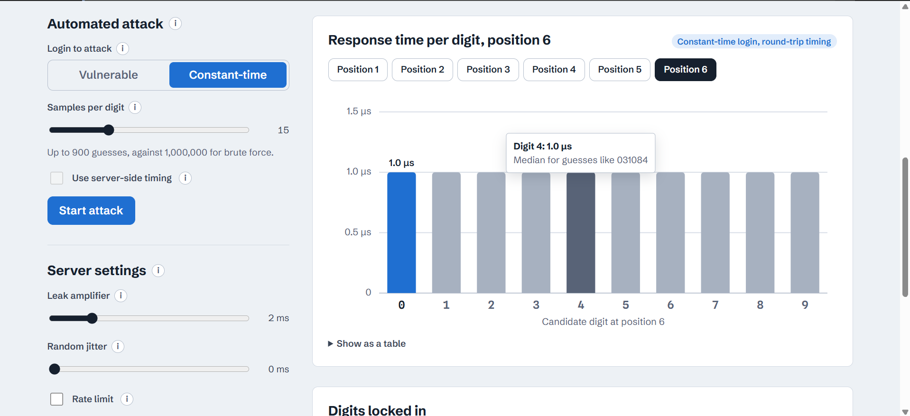

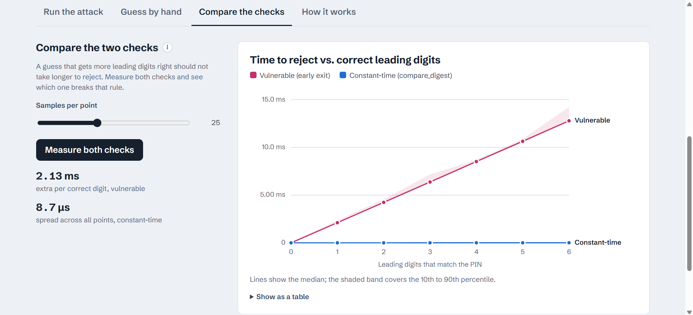

### B. Countermeasures

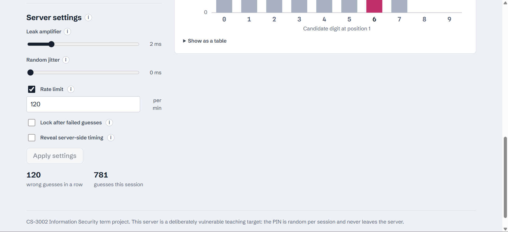

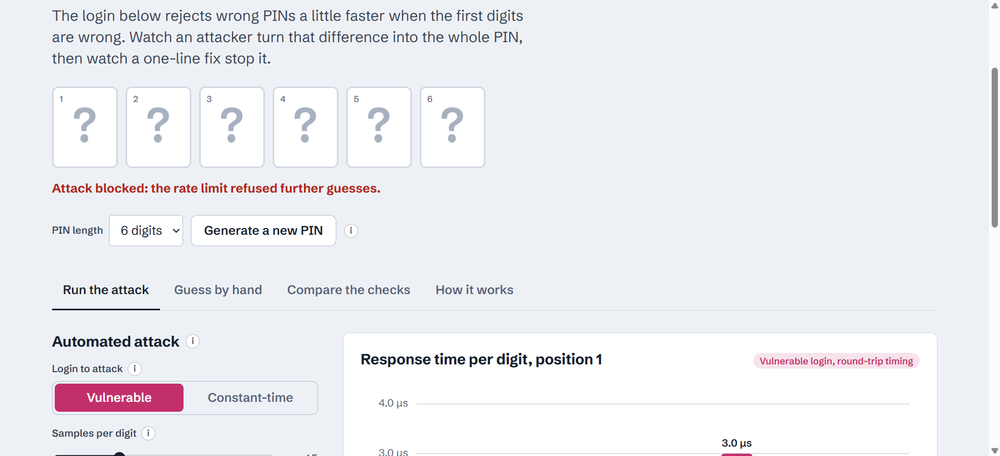

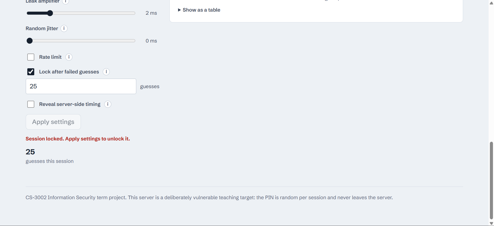

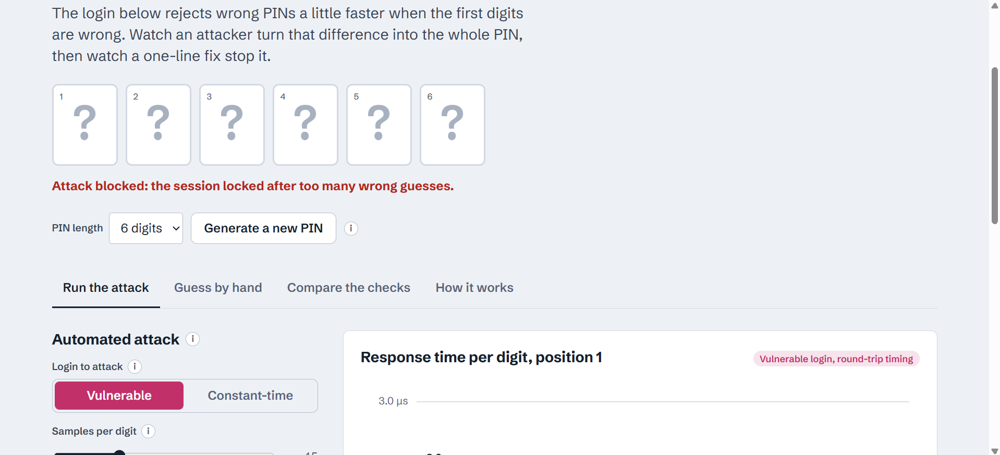

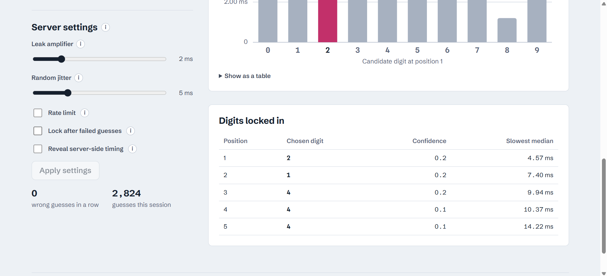

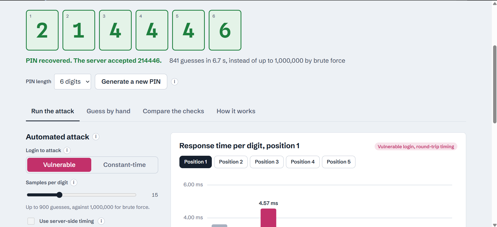

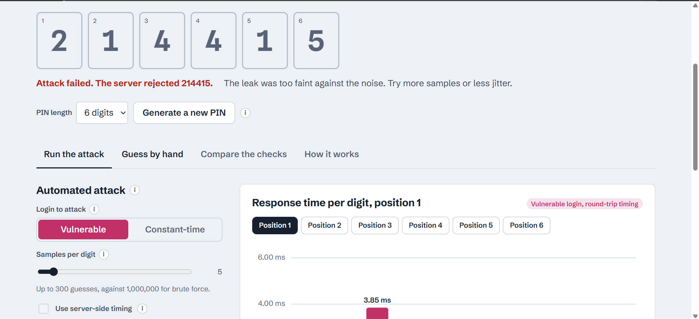

### C. Real leak

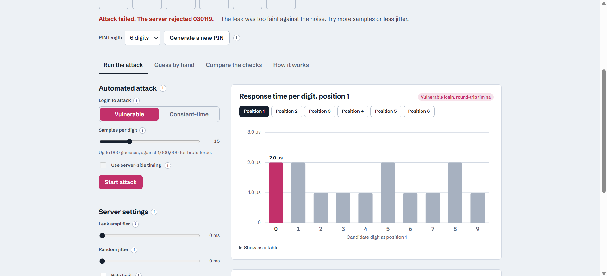

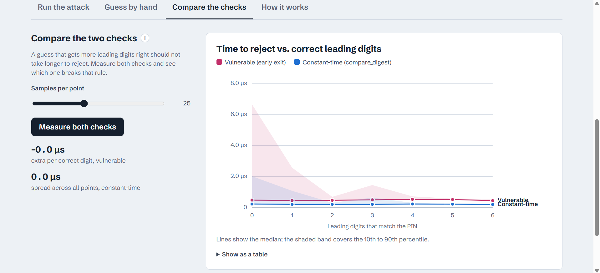

### D. Deployment

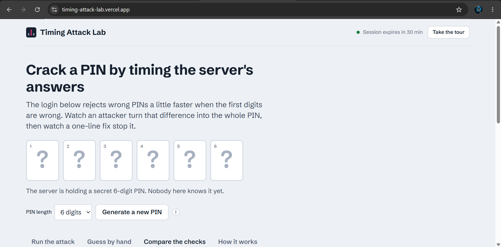

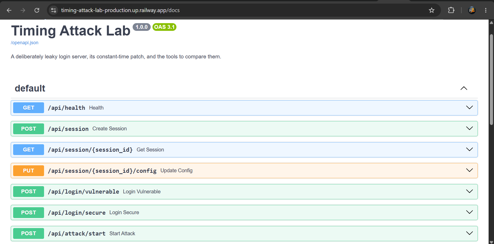

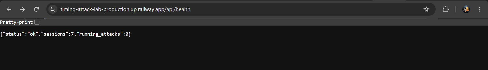

In the recorded test run, the vulnerable attack recovered the PIN in **2,551 guesses and 13.7 seconds**. The constant-time endpoint resisted **3,001 failed attempts** with no recovery.

## Known limitations

- The attack uses `0` to fill positions it has not tested yet. If those zeroes complete the real PIN, `recover_pin` returns immediately, so the last position may be missing from the history. This known edge case was left unfixed.
- Jitter alone does not stop the attack. It helps only when combined with limited sampling, rate limiting, or lockout.
- Real internet latency hides the tiny timing difference, which is why the demo has a leak amplifier.

## Security and usability tradeoffs

Jitter makes real logins slower. Lockout can block real users, including when someone deliberately sends failed guesses. Rate limiting can also slow down honest retries. Constant-time comparison addresses the timing leak without adding these delays.

## Ethical use

This project is for education only. Run the attack only against your own demo session.

## Credits

CS-3002 Information Security term project. Team roles are listed above.